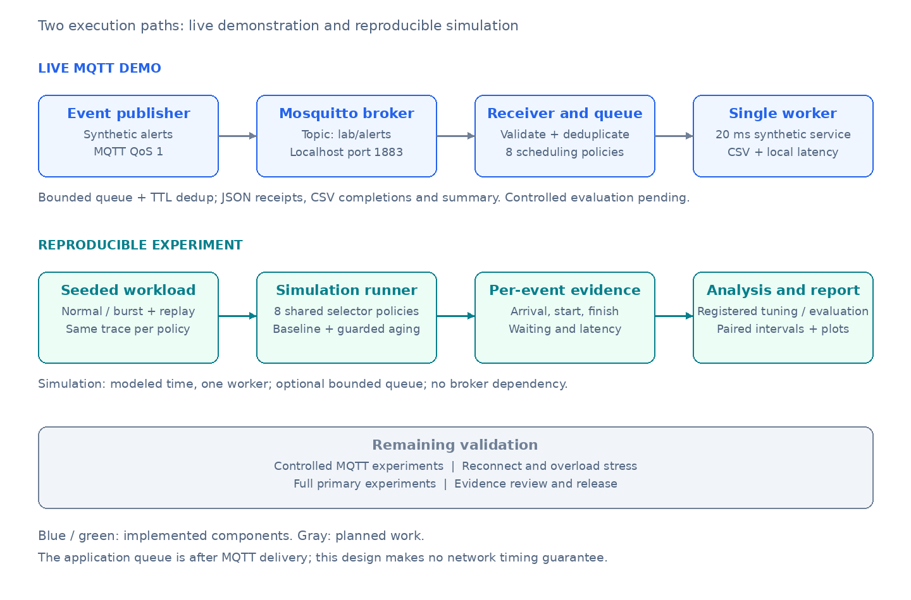
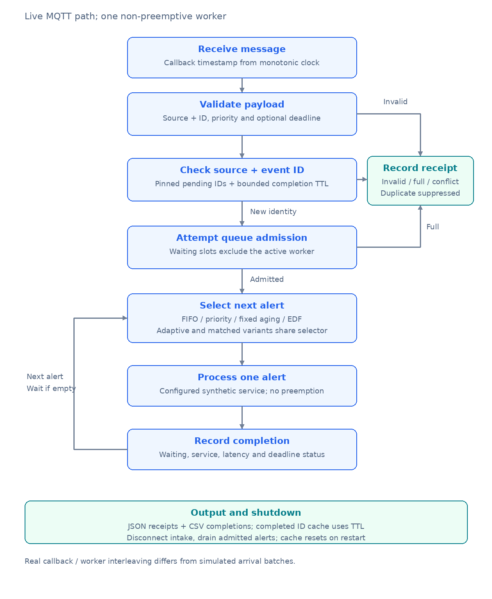

# IoT Priority Alert System

Explore the tradeoff between urgent alert latency and routine event waiting using MQTT and reproducible scheduling experiments.

- **Policies:** FIFO, strict priority, fixed aging, EDF and experimental guarded adaptive aging.
- **Simulator:** bounded or unbounded queues, per-event service times and deadline metadata.
- **Experiments:** seeded normal/burst traffic, variable processing costs, trace replay and deadline/loss summaries.
- **MQTT demo:** simulated publishers, Mosquitto and a single processing worker.

Research prototype. Fixed aging runs in the simulator; the live demo supports FIFO and strict priority.

## Architecture



<details>
<summary>View alert processing flow</summary>



</details>

## Quick start

Python 3.11+; no hardware or extra packages needed for simulation.

```bash
git clone https://github.com/rhidoyhasanmahmud/iot-priority-alert-system.git
cd iot-priority-alert-system
python -m iot_alerts.experiment --output results/run
```

Results are saved as CSV files in `results/run/`.

[MQTT setup and full instructions →](docs/getting-started.md)

## Documentation

- [Research proposal](docx/IoT_Alert_Processing_Research_Proposal.docx)
- [Simulator foundation](docs/simulator-foundation.md)
- [EDF and baseline comparison](docs/edf-baseline.md)
- [Workload generation and replay](docs/workload-generator.md)
- [Deadline and loss metrics](docs/deadline-and-loss-metrics.md)
- [Candidate scheduler usage](docs/research/candidate-implementation.md)
- [Research design review and candidate specification](docs/research/design-review.md)
- [Design and evaluation](docs/design-and-evaluation.md)
- [Related work](docs/related-work.md)
- [Application scenario](docs/application-scenario.md)
- [Pilot results and reproduction](evidence/pilot/README.md)

The pilot uses synthetic traffic. The adaptive scheduler is experimental; comparative evaluation and live performance validation remain planned.
